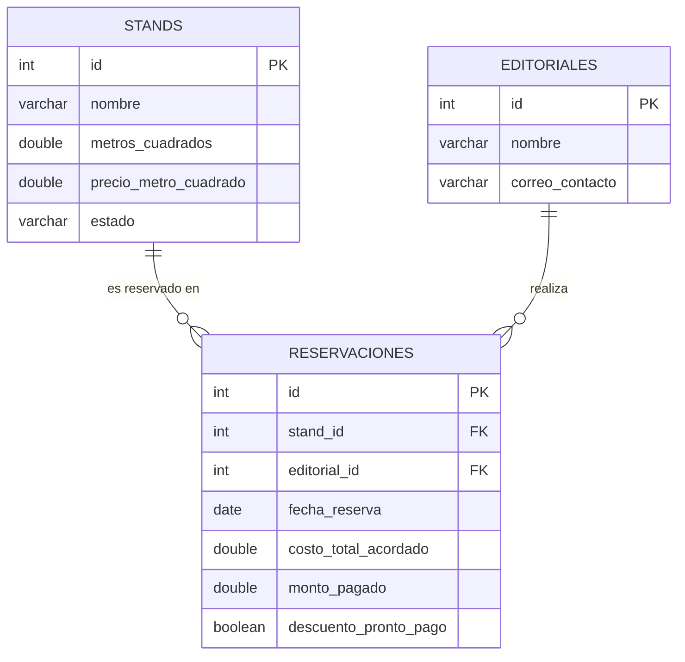
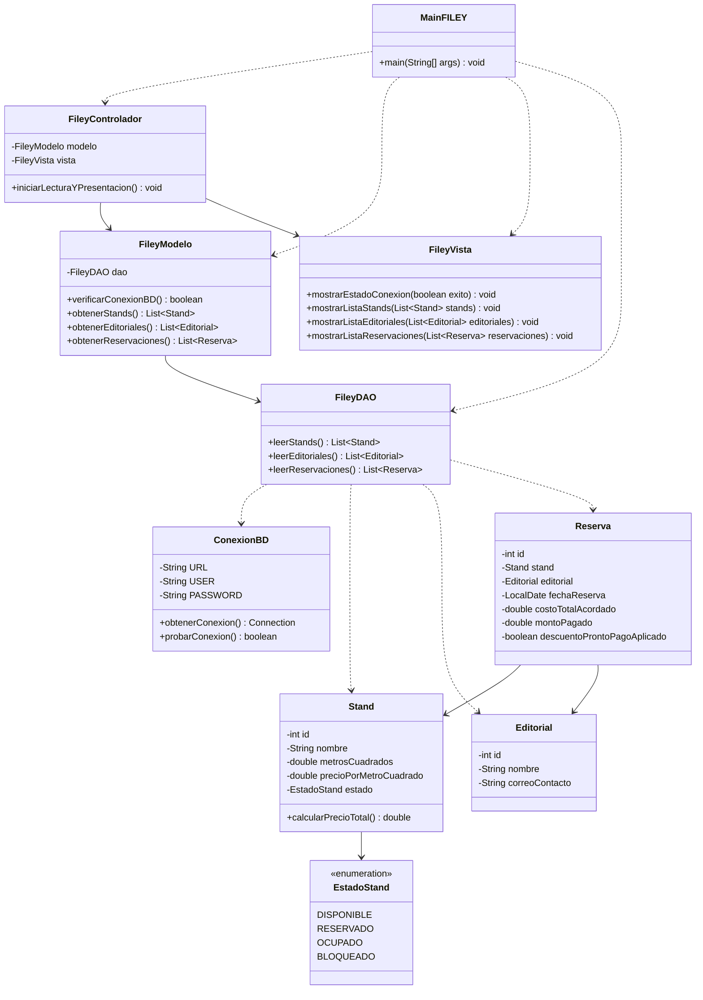

# PD4 - Base de Datos en la Nube y Patron MVC (Sistema FILEY)

Link del video: https://youtu.be/hMOF6pcTCbE

## 1. Documentacion de lo implementado

En esta practica retomé el codigo de las entidades del sistema de la FILEY hecho en la PD2 (`Stand`, `Editorial`, `Reserva` y `EstadoStand`) para conectarlo a una base de datos relacional alojada en la nube (PostgreSQL en Neon.tech) usando **JDBC** y organizando la arquitectura con el patron **MVC + capa de Base de Datos**.

Lo que se implementó por capas:

1. **Base de datos en la nube:**
   - Creé las tres tablas relacionales (`stands`, `editoriales` y `reservaciones`) en la nube. La tabla `reservaciones` tiene llaves foraneas (`stand_id` y `editorial_id`) que apuntan a las tablas de stands y editoriales.

2. **Capa de Base de Datos (`bd`):**
   - `ConexionBD`: maneja la conexion con la base de datos en la nube mediante `DriverManager.getConnection(...)` y tiene el metodo `probarConexion()` para verificar que el servidor responde bien.
   - `FileyDAO`: implementa las lecturas con JDBC (`PreparedStatement` y `ResultSet`). Tiene los metodos `leerStands()`, `leerEditoriales()` y `leerReservaciones()`. Para las reservaciones utilicé un `INNER JOIN` en SQL para reconstruir los objetos `Reserva` completos con su `Stand` y su `Editorial`.

3. **Patron MVC (`mvc` y `datos`):**
   - **Modelo (`FileyModelo` y paquete `datos`):** guarda la representacion de las entidades y se comunica con `FileyDAO` para recuperar las listas de datos sin que la vista conozca el codigo SQL.
   - **Vista (`FileyVista`):** se encarga unicamente de mostrar en consola el estado de la conexion y presentar de forma clara las listas de cada tabla.
   - **Controlador (`FileyControlador`):** coordina el flujo. Pide al modelo verificar la conexion y obtener las listas de Stands, Editoriales y Reservaciones, y luego se las pasa a la vista para mostrarlas.

## 2. Diagrama Entidad-Relacion (E-R)

## 3. Diagrama de Clases UML (MVC + Capa de BD)

